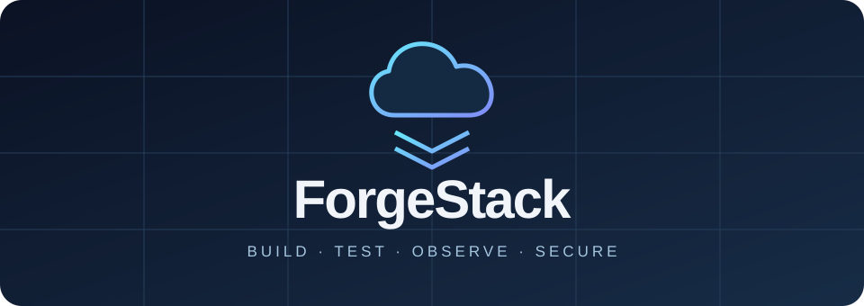

<p align="center">
  
</p>

<h1 align="center">ForgeStack</h1>

<p align="center">
  <strong>A hands-on cloud engineering lab — from your first Go API to secure infrastructure.</strong>
</p>

<p align="center">
  <a href="LICENSE"></a>
  
  
  
  
  
</p>

<p align="center">
  <a href="#first-5-minute-run-no-aws-account-no-cloud-bill">Quick start</a> ·
  <a href="docs/ROADMAP.md">Learning roadmap</a> ·
  <a href="docs/COMMANDS.md">Command reference</a> ·
  <a href="CONTRIBUTING.md">Contributing</a>
</p>

---

ForgeStack is a progressively expanded, cost-conscious engineering learning repository for an
Apple M4 Mac. Build a Go API, run local containers, practice automated code review, and explore
AWS infrastructure through explicit, opt-in exercises.

Start locally with **no AWS account and no cloud bill**. Follow the learning path as you add
new tools, investigate failures, and document what you learn.

## Table of contents

- [What runs today](#what-runs-today-starter-milestone)
- [Current limitations](#not-yet-implemented-future-lessons)
- [Requirements](#mac-m4-requirements)
- [Quick start](#first-5-minute-run-no-aws-account-no-cloud-bill)
- [Docker lab](#docker-lab)
- [Repository layout](#repository-layout)
- [Code review and CI](#pr-safety-code-review-and-ci)
- [Documentation site](#documentation-site)
- [AWS and Terraform](#aws--terraform-no-automatic-charges)
- [Learning philosophy](#learning-philosophy)
- [Claude Code assistant](#claude-code-ai-engineering-assistant)
- [Community and license](#community-and-license)

## What runs TODAY (starter milestone)

- Go API built using the standard library plus go-kit layering (`GET /healthz`, `GET /readyz`,
  `GET /metrics-demo`, `GET/POST /api/v1/posts`).
- Input validation, request-body limit, bounded pagination, structured logs, safe timeouts,
  graceful shutdown, concurrency-safe in-memory storage.
- Unit, HTTP and concurrency tests, Docker multi-stage image, Compose API.
- Optional local PostgreSQL + Redis services (`data` profile), optional ClickHouse service
  (`analytics` profile); sample SQL initialization.
- CI formatting, tests, race detection, `golangci-lint`, govulncheck, CodeQL, secret scanning
  (gitleaks), container image scanning (Trivy), PR reviewdog, a custom repository reviewer,
  Terraform validation/IaC checks, and Dependabot.
- A documentation site (Docusaurus) that renders this repo's own `docs/` directory, including
  reference pages generated and kept in sync automatically from source by `cmd/docgen`.
- **Opt-in** Terraform S3 exercise that creates no AWS resources by default.

## Not yet implemented (future lessons)

**IMPORTANT:** API posts are in memory and disappear on restart. PostgreSQL, Redis, and
ClickHouse are running practice services but **are not yet wired to API endpoints**. There is no
authentication, user accounts, production metrics, managed deployment or AI reviewer in this
starter. Do not expose this demo API publicly or use it with sensitive user data. See
[docs/PRODUCTION_READINESS.md](docs/PRODUCTION_READINESS.md) for an evidence-labeled gap
analysis of what's implemented vs. missing.

## Mac M4 requirements

- Apple silicon/macOS; Git; Go 1.23+ for local standard-library code (CI uses Go 1.27.4); Docker
  Desktop (Apple silicon) for containers; Python 3 for review script; Node.js 22 only if you're
  building the docs site locally.
- AWS CLI, Terraform and kubectl are **optional for this first milestone**.
- Check what is already installed: `bash scripts/check-env.sh`.
- See `docs/COMMANDS.md` for every important command, flag, expected outcome and safe undo.

## First 5-minute run (no AWS account, no cloud bill)

```bash
# from this repository root
go test ./...
go run ./cmd/api
# in a second terminal:
curl -i http://localhost:8080/healthz
curl -i -X POST http://localhost:8080/api/v1/posts -H 'Content-Type: application/json' -d '{"author":"Nia","text":"Hello Alex"}'
curl -i http://localhost:8080/api/v1/posts
```

Stop with Ctrl+C. `make test`, `make race`, `make vet`, `make lint` and `make smoke` also work
(smoke requires API running).

## Docker lab

```bash
make docker-up                  # API only, localhost:8080
make smoke
make docker-data                # add PostgreSQL and Redis; localhost only
make docker-analytics           # add ClickHouse; uses more RAM
make docker-down                # stop everything, retain database volumes
# ONLY if you want to permanently erase local data:
make docker-clean
```

On the M4, use the Apple-silicon Docker installer. Optional ClickHouse may require more Docker
memory. The Compose ports are bound to `127.0.0.1` deliberately.

## Repository layout

- `cmd/api`, `internal/api`: Go application and tests
- `cmd/docgen`: generates `docs/generated/*` directly from source; CI fails if these drift
- `databases/postgres`: SQL lab schema
- `compose.yaml`, `Dockerfile`: local containers
- `infrastructure/terraform/aws-s3-sandbox`: safe-by-default opt-in Terraform example
- `website/`: Docusaurus site that publishes `docs/` to GitHub Pages
- `.github/workflows`: CI, lint, security, container-scan, docs-check, Pages deploy and
  Terraform-check workflows (NO cloud auto deploy)
- `scripts/review_guard.py`: offline automated code review baseline
- `docs/ROADMAP.md`: full 25-module course, certification and failure exercises
- `docs/AUTOMATED-CODE-REVIEW.md`: security, reviewdog, branch rules and optional future AI reviewer
- `docs/PRODUCTION_READINESS.md`: evidence-based audit of implemented vs. missing production concerns
- `docs/SECURITY-AUDIT.md`: pre-publication security findings and remaining risks
- `docs/COST-SAFETY.md`: cost safeguards and teardown procedure
- `docs/COMMANDS.md`: command explanations
- `docs/architecture/`, `docs/adr/`: module architecture notes and accepted ADRs
- `docs/cost-reports/`, `docs/incidents/`: operational logs

## PR safety, code review and CI

```bash
python3 scripts/review_guard.py --ci
make test
make race
make vet
make lint     # golangci-lint, same config CI enforces (.golangci.yml)
```

When pushed to GitHub, PRs run automated checks — `golangci-lint`, race-detected tests,
govulncheck, CodeQL, gitleaks secret scanning, Trivy container image scanning, Terraform
validate/IaC checks, a docs build/link check, and (on same-repo PRs) reviewdog annotations. See
`docs/AUTOMATED-CODE-REVIEW.md` for exactly which checks are required/enforceable vs. advisory,
and how to enable branch protection, CODEOWNERS and additional GitHub security features.
Workflow permissions and advanced GitHub security availability depend on your repository
settings. Third-party Action versions must be vetted/pinned to commit SHA for production use.

## Documentation site

`docs/` is also published as a browsable Docusaurus site via GitHub Pages
(`.github/workflows/pages-deploy.yml`, deploys on push to `main`; every PR runs a build-only
check so a broken site fails before merge). The site renders this repository's own `docs/`
directory directly — nothing is duplicated, so it can't drift from the repo. One-time manual
repository setting required before it goes live: see
[docs/GITHUB-PAGES-SETUP.md](docs/GITHUB-PAGES-SETUP.md). Build it locally with:

```bash
cd website
npm ci
npm start      # local preview
npm run build  # static build, same as CI
```

## AWS + Terraform (no automatic charges)

**AWS account not needed for initial exercises.** When ready, read `docs/COST-SAFETY.md` and
`infrastructure/terraform/aws-s3-sandbox/README.md`. The Terraform sample creates zero resources
unless explicitly opted in. GitHub workflows never run `terraform apply` or `destroy`.

## Learning philosophy

For each experiment: **build → test → intentionally break in your sandbox → observe →
diagnose → fix → add regression test → security review → document → clean up**. Publish
reproducible commits/PRs, not just screenshots. See `docs/ROADMAP.md`.

## Claude Code AI engineering assistant

This repository contains a complete `.claude/` starter with project memory (`CLAUDE.md`),
coding/security/cost rules, reusable skills, read-only specialist agents and blocking hook
guardrails. See [.claude/README.md](.claude/README.md).

```bash
# Run in project root, after installing/authenticating Claude Code separately:
claude
# Inside Claude Code:
/start-lab
/code-review
/security-review
```

AI code review is **available locally on demand** through `/code-review`; it is **not a live
GitHub AI PR bot**. Existing GitHub PR automation uses golangci-lint, Reviewdog, Go checks,
CodeQL, gitleaks and Trivy. A GitHub-integrated AI reviewer requires explicit installation,
authorization, repository configuration and possibly usage charges.

## Community and license

Contributions are welcome. Read the [contribution guide](CONTRIBUTING.md) and
[code of conduct](CODE_OF_CONDUCT.md) before opening a pull request. To report a security
issue, follow the [security policy](SECURITY.md).

ForgeStack is licensed under the [Apache License 2.0](LICENSE).
