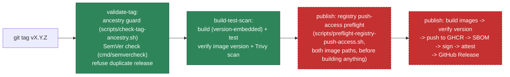

# Trusted releases

**Status: exercised twice for real (`v0.1.0` and `v0.1.1`), both partially succeeded, a
second round of fixes applied, not yet re-attempted.** `validate-tag` and `build-test-scan`
have both now run live and passed on both attempts; `publish` has run live twice and failed
partway through each time, at a **different** step each time. See "`v0.1.0` failed-attempt
history" and "`v0.1.1` failed-attempt history" below for exactly what happened, what state
the repository is in right now, and what changed as a result before any next attempt.

## Pipeline overview



**The tagged commit must be reachable from `main`** — enforced by a real `git merge-base
--is-ancestor` check (`scripts/check-tag-ancestry.sh`), not documented practice alone. It
fails closed: a shallow clone, a missing ref, or a commit this repository doesn't know
about are all treated as failure, never as "assume it's fine." Tested against real git
fixtures (a valid `main` commit, a feature-only commit never merged, a missing commit, a
missing ref, and a shallow clone) in `scripts/test-check-tag-ancestry.sh` — run it by hand
whenever the guard itself changes. This is the very first step of `validate-tag`, which
every other job (`build-test-scan`, `publish`) depends on via `needs:` — nothing builds,
signs, or publishes before it passes.

The `publish` job is the one carrying privileged credentials (`contents: write`,
`packages: write`, `id-token: write`, `attestations: write`) and is drawn as the
not-yet-verified step. `validate-tag` and `build-test-scan` are identical in trust level to
every other CI job in this repository.

## `v0.1.0` failed-attempt history

**2026-11-13, first-ever live run of `release.yml`.** Tag `v0.1.0` pushed against the
verified `main` commit `7a507f3cbd06a8d6b9652208ce00f46e979e4d10`.

### What happened, confirmed from the actual job logs

- `validate-tag`: **passed**. Ancestry guard confirmed the commit reachable from `main`;
  `v0.1.0` validated as real SemVer; no pre-existing release for that tag.
- `build-test-scan`: **passed**. Build, race-detected tests, both Trivy scans all clean.
- `publish`: **failed partway through.**
  - `ghcr.io/mangopep/forgestack:v0.1.0` — pushed **successfully**, digest
    `sha256:671b4e3e74900e7c3b241d68cb11c8d86025c3465eee46b407d26d4a023f1861`.
  - `ghcr.io/mangopep/forgestack-python-api:v0.1.0` — several layers uploaded, then
    `error from registry: denied` on the final manifest push. The tag never resolves;
    `docker pull` against it returns "not found."
  - Everything after the failed push (digest resolution, cosign install, **signing**,
    **attestation**, **GitHub Release creation**) was correctly **skipped** by the
    job's own fail-fast behavior — confirmed via `gh run view`'s per-step status. No
    signature, no attestation, no Release exist for either image.

### Diagnosis — confirmed vs. hypothesis, kept separate on purpose

**Confirmed** (from logs and independent verification after the run):
- The Go image push succeeded and is genuinely pullable (`docker pull --platform
  linux/amd64 ghcr.io/mangopep/forgestack@sha256:671b4e...`, tested, worked, container ran,
  `/healthz` responded).
- The Go image's running container reported `"version":"dev"`, not `"v0.1.0"` — a **second,
  separate, confirmed bug**: `release.yml`'s `publish` job built the image with plain
  `docker build` (no `--build-arg VERSION=...`), and neither Dockerfile had an `ARG`/`ENV`
  wired to receive one. The version embedding was never actually connected to the real
  Docker build path — only to a throwaway native `go build` in `build-test-scan` that
  built a binary nothing else used. **Fixed** — see "What changed" below.
- No signature, no attestation, no GitHub Release exist for either image (`cosign verify`:
  `no signatures found`; `gh attestation verify`: `404`; `gh release view`: not found).
- Docker's own push error output provided no detail beyond the literal string `"denied"` —
  this is a known limitation of the Docker CLI's push error reporting, not something this
  investigation chose to omit.

**Hypothesis, not confirmed** (the actual root cause of the GHCR "denied"):
- The most likely explanation is a GHCR first-time-package-creation permission nuance
  specific to a package name that differs from the repository name
  (`forgestack-python-api` vs. the repository `forgestack`) — the identically-configured
  push to the repository-matching package name (`forgestack`) succeeded moments earlier
  with the same token, in the same job.
- **Could not be independently confirmed**: inspecting GHCR's own package settings (visibility,
  repository linkage, creation history) requires `read:packages` scope, which this
  investigation's GitHub CLI session does not have — and was not requested, since
  expanding token scope wasn't asked for and this investigation stayed within read-only,
  already-available access. GitHub's public package pages for both `forgestack` and
  `forgestack-python-api` both return HTTP 200, which is inconclusive (the page renders
  generically regardless of whether a package has any pushed versions).
- **This is the one unresolved external blocker** this investigation could not close. The
  new preflight check below (`scripts/preflight-registry-push-access.sh`) is built to catch
  this class of problem *before* any image is built on the next real attempt, but the
  preflight script itself has only been verified against its failure path (confirmed
  against live GHCR with an invalid token) — its success path has not been proven against
  real valid credentials, since doing so would require an actual push attempt.

### What changed as a result (this branch)

1. **Version embedding, fixed in both Dockerfiles.** `Dockerfile` and
   `apps/python-api/Dockerfile` now accept `ARG VERSION` (defaulting to `dev` /
   `docker-build` for ordinary, non-release builds) and wire it into the Go `ldflags`
   / Python `SERVICE_VERSION` respectively. `release.yml` now passes
   `--build-arg VERSION=<tag>` when building release images, in both the
   `build-test-scan` and `publish` jobs.
2. **A real test for this, `scripts/verify-release-image-version.sh`**, runs the built
   image and asserts `/healthz`'s `version` field matches the expected release version —
   wired into `build-test-scan` (fails the build before any push is attempted) and into
   `publish` immediately after building the real images (fails before any push). Verified
   locally: passes for both languages when the build-arg is supplied, fails correctly (and
   clearly) when it isn't — the exact bug `v0.1.0` shipped.
3. **A new registry push-access preflight**, `scripts/preflight-registry-push-access.sh`,
   probes push permission for both image paths (via a blob-upload session that's
   immediately cancelled — nothing becomes publishable) *before* any image is built.
   Confirmed working against the real GHCR server for its failure path; its success path
   is unverified (see "Diagnosis" above).
4. **Explicit partial-failure reporting**: `publish` now writes a clear
   `$GITHUB_STEP_SUMMARY` block on any failure, naming the exact commands to run before
   assuming anything about the release's state — never silently leaving a reader to infer
   it from which steps show a red X.

### Current state of `v0.1.0` — nothing further touched

| Artifact | State |
|---|---|
| Tag `v0.1.0` | exists, points at the correct commit — **not moved or deleted** |
| `ghcr.io/mangopep/forgestack:v0.1.0` | published, unsigned, unattested, reports `version: "dev"` — **not deleted or replaced** |
| `ghcr.io/mangopep/forgestack-python-api:v0.1.0` | does not exist (tag never resolved) |
| GitHub Release `v0.1.0` | does not exist |

### Recovery procedure for this exact situation

Per policy, `v0.1.0` is **never** reused, moved, or force-overwritten, and the dangling Go
image is **never** silently deleted as a reflex:

1. Confirm the current state yourself before acting on anything above (the exact commands
   are in `publish`'s own failure summary, and above).
2. The next release attempt uses a **new** tag — `v0.1.1` (prepared below, not yet created
   or pushed).
3. `v0.1.0`'s dangling, unsigned Go image is left in place unless/until a separate,
   explicit decision is made to delete it — that decision belongs to whoever owns the
   registry, not to this automation.

## `v0.1.1` failed-attempt history

**2026-11-13, second live run of `release.yml`.** Tag `v0.1.1` pushed against the verified
`main` commit `90da9d887cafb8324c3b2d9826dba52ed57c1ec3` (`go run ./cmd/semvercheck compat
v0.1.0 v0.1.1` classifies it as `patch`, consistent with this being a repair of `v0.1.0`'s
own release pipeline, not a new feature).

### What happened, confirmed from the actual job logs

- `validate-tag`: **passed.**
- `build-test-scan`: **passed** — including `scripts/verify-release-image-version.sh`,
  which confirmed the version-embedding fix works for real this time.
- `publish`: **failed partway through, at a different, later step than `v0.1.0`.**
  - Preflight push-access probe: **passed** — the original `v0.1.0` GHCR "denied" problem
    did **not** recur.
  - Both images built, version-verified, SBOM'd, and **pushed successfully** — unlike
    `v0.1.0`, where the Python image's push failed. `ghcr.io/mangopep/forgestack:v0.1.1`
    digest `sha256:b27b2bc3335740bfd1329c6e227015d41b2d4006959966d0f9758fe40e7f5b27`;
    `ghcr.io/mangopep/forgestack-python-api:v0.1.1` digest
    `sha256:421e1663089d124185fbfcd2e3bbd34886dbb86cc3b896d185b155bcf7a3f7f2`.
  - Both images **signed successfully** (`cosign sign`, confirmed independently afterward
    with a fresh `cosign verify` against both digests — valid, keyless, bound to this
    workflow run).
  - **"Attest build provenance for the Go image digest" failed**: `Error: subject-digest
    must be in the format "sha256:<hex-digest>"`. The Python attestation step was
    correctly **skipped** (sequential), and "Create the GitHub Release" was correctly
    **skipped** (atomic-last design worked exactly as intended).

### Diagnosis — confirmed, not a hypothesis this time

The digest-resolution step computed `go_digest`/`py_digest` via `docker inspect --format=
'{{index .RepoDigests 0}}'`, which returns the **full** reference
(`ghcr.io/mangopep/forgestack@sha256:<hex>`), and passed that whole string straight into
`actions/attest-build-provenance`'s `subject-digest` input — which accepts only the bare
`sha256:<hex>` portion. This bug was introduced during the `v0.1.0` repair and was never
exercised live before `v0.1.1`, because it requires an actual pushed image digest: F4's
`supply-chain-attest.yml` attests local SBOM *files* via `subject-path` (hashing file
content), a completely different code path that never touches this string.

This was independently confirmed after the run, not just taken from the job's own report:
both images were freshly re-pulled by digest (`docker pull --platform linux/amd64`), both
ran and correctly reported `version: v0.1.1` on `/healthz`, both signatures independently
re-verified with `cosign verify`, no GitHub Release exists (`gh release view v0.1.1`: not
found), and no GitHub-native attestation exists for either image (`gh attestation verify`:
`404` for both — Go's failed, Python's was skipped).

### What changed as a result (this branch)

1. **Two small, independently-tested scripts replace the inline digest extraction**:
   `scripts/select-single-repo-digest.sh` fails closed if a `RepoDigests` array is missing
   (empty) or ambiguous (more than one entry) instead of blindly indexing `[0]`;
   `scripts/validate-image-digest.sh` strictly validates the `name@sha256:<64-hex>` shape
   and extracts just the bare digest, failing closed on anything malformed (wrong length,
   uppercase, wrong algorithm, embedded whitespace, more than one `@`, trailing garbage).
   Regression tests (`scripts/test-select-single-repo-digest.sh`,
   `scripts/test-validate-image-digest.sh`) use the **real** digests from this `v0.1.1`
   attempt as their positive cases.
2. **The full reference is kept alongside the bare digest** (`go_digest_full`/
   `py_digest_full` outputs) — `cosign sign` and the release notes still use the full,
   human-readable reference; only the two `attest-build-provenance` steps use the bare
   digest, which is what actually needed fixing.
3. **A new post-attestation verification step**, `scripts/verify-release-attestation.sh`,
   re-reads each attestation back independently via `gh attestation verify` and asserts its
   subject digest, source commit, and workflow ref all match what this run actually
   published — rather than trusting the action did the right thing without checking.
   **Not yet runtime-verified end-to-end**: doing so requires a real tag push whose
   attestation step actually succeeds, which this phase of work (local-only, no publishing)
   is not authorized to perform.
4. Tag ancestry checks, version embedding, signing, Trivy/SBOM scanning, job permissions,
   and the `publish` job's partial-failure reporting are all **unchanged** by this fix.

### Current state of `v0.1.1` — nothing further touched

| Artifact | State |
|---|---|
| Tag `v0.1.1` | exists, points at the correct commit — **not moved or deleted** |
| `ghcr.io/mangopep/forgestack:v0.1.1` | published, signed, correctly reports `version: "v0.1.1"`, **unattested** — **not deleted or replaced** |
| `ghcr.io/mangopep/forgestack-python-api:v0.1.1` | published, signed, correctly reports `version: "v0.1.1"`, **unattested** (attestation step was skipped) — **not deleted or replaced** |
| GitHub Release `v0.1.1` | does not exist |

### Recovery procedure for this exact situation

Per the same policy as `v0.1.0`: `v0.1.1`'s two signed-but-unattested, unreleased images are
**never** reused, moved, deleted, or force-overwritten as a reflex. The next release attempt
(once this fix is separately approved and actually exercised live) uses the same `v0.1.1`
tag only if no release exists for it yet (`validate-tag`'s duplicate-release check already
enforces this) — or a new patch tag, if a human decides the images already published for
`v0.1.1` should be left in place and superseded instead.

## Preventing accidental duplicate versions, tag overwrites, and partial releases

- **Duplicate tag/version**: `validate-tag` calls `gh release view <tag>` before anything
  else runs; if a release already exists for that tag, the whole workflow fails
  immediately — nothing is built, nothing is pushed.
- **Tag overwrite**: Git tags are not deleted/re-pushed as part of any ForgeStack
  automation. If a human force-pushes a tag to a different commit, the duplicate-release
  check above still catches it (the release for that tag name already exists) — it does
  not re-publish over it.
- **Partial release**: the GitHub Release itself is created as the **last** step of the
  `publish` job, after images are pushed, SBOMs generated/validated, and signatures/
  attestations created. If any earlier step fails, the job fails and no Release is
  created — there is no state where a Release exists but its artifacts don't (or vice
  versa) from a single run. **This is not hypothetical** — `v0.1.0`'s real first attempt
  hit exactly this: one image pushed, the other failed, and because the Release step
  never ran, no Release exists for either. See "`v0.1.0` failed-attempt history" above for
  the full account and current state. A failed run before the Release step leaves GHCR
  with a tagged-but-unreleased image; this is a known, accepted gap (see "Rollback" below)
  rather than something an atomic-transaction mechanism was built to prevent — GHCR itself
  has no multi-artifact transaction primitive to build on.

## Evidence chain: release version → source commit → build → artifact digest → SBOM → attestation

Every release artifact's metadata links all the way back to source, recorded explicitly
(not left to be inferred):

| Link | Where it's recorded |
|---|---|
| Release version → source commit | The GitHub Release's own `tag_name` (the tag IS a commit pointer) and the release notes include `github.sha` explicitly |
| Source commit → build | `release.yml`'s `build-test-scan` job builds directly from the checked-out tag's commit; the Go binary is built with `-ldflags -X .../buildinfo.Version=<tag>` |
| Build → artifact digest | `docker inspect --format '{{json .RepoDigests}}'` immediately after push, resolved through `scripts/select-single-repo-digest.sh` (fails closed if missing or ambiguous) — the digest, not the mutable tag, is what gets signed and attested |
| Artifact digest → SBOM | `cmd/sbomcheck augment` records the exact `forgestack:commit` property in the SBOM's metadata, generated from the same pushed image |
| Artifact digest → attestation | `actions/attest-build-provenance`'s `subject-digest` input is the **bare** `sha256:<hex>` digest (never the full `name@sha256:<hex>` reference — `v0.1.1`'s real failure, see above, and now extracted and validated by `scripts/validate-image-digest.sh` rather than inline string slicing), matching F4's already-verified pattern (see `docs/adr/0005-f4-security-supply-chain.md`'s live verification of `supply-chain-attest.yml`) |

## Local fixture verification (what was actually run this phase)

No registry push, no real tag, no live GHCR/GitHub Release credentials. Verified instead:

```bash
# 1. SemVer validation + compatibility classification (real tool, real tests)
go run ./cmd/semvercheck validate v1.0.0
go run ./cmd/semvercheck compat v1.0.0 v2.0.0   # -> breaking
go run ./cmd/semvercheck compat v1.0.0 v1.1.0   # -> compatible

# 2. Build a local image, generate + augment + validate its SBOM (same
#    tools release.yml's publish job uses, just not pushed anywhere)
docker build -t forgestack:release-fixture .
syft forgestack:release-fixture -o cyclonedx-json=sbom-fixture.cdx.json
go run ./cmd/sbomcheck augment --producer "ForgeStack Release" \
  --repository mangopep/forgestack --commit "$(git rev-parse HEAD)" \
  sbom-fixture.cdx.json sbom-fixture.augmented.cdx.json
go run ./cmd/sbomcheck validate sbom-fixture.augmented.cdx.json

# 3. Sign + verify the fixture SBOM locally (same cosign commands, local
#    key instead of the live keyless/OIDC flow -- see F4's ADR for why
#    that distinction matters and is stated honestly, not glossed over)
cosign generate-key-pair
cosign sign-blob --key cosign.key --bundle sbom-fixture.augmented.cdx.json.bundle sbom-fixture.augmented.cdx.json
cosign verify-blob --key cosign.pub --bundle sbom-fixture.augmented.cdx.json.bundle --insecure-ignore-tlog sbom-fixture.augmented.cdx.json
```

## Verifying a real release (once one exists)

```bash
# Signature (keyless, repository-scoped identity)
cosign verify "ghcr.io/mangopep/forgestack:vX.Y.Z" \
  --certificate-identity-regexp '^https://github.com/mangopep/forgestack/' \
  --certificate-oidc-issuer 'https://token.actions.githubusercontent.com'

# Provenance (GitHub-native attestation)
gh attestation verify oci://ghcr.io/mangopep/forgestack:vX.Y.Z --owner mangopep

# SBOM (attached to the GitHub Release)
gh release download vX.Y.Z --repo mangopep/forgestack --pattern 'sbom-*.cdx.json'
go run ./cmd/sbomcheck validate sbom-go.cdx.json
```

## Rollback

Releases are never rebuilt "fresh" to roll back — the whole point of digest-pinning is
that a prior release's exact bytes are still pullable:

```bash
docker pull ghcr.io/mangopep/forgestack@sha256:<previous-release-digest>
```

If a partial release occurred (images pushed, no GitHub Release — see "partial releases"
above, and `v0.1.0`'s real incident above): deleting the orphaned GHCR image is an
available action (`gh api -X DELETE ...` or the GHCR UI), but it is a deliberate, separate,
human decision — not an automatic cleanup step, and not something to do as a reflex the
moment a failure is noticed. Confirm the actual state first (the commands in `publish`'s
own failure summary). Either way, the next attempt uses a **new** patch tag — never reuse
the failed tag name.

## Security notes

- The `publish` job's elevated permissions (`contents: write`, `packages: write`,
  `id-token: write`, `attestations: write`) are declared on that job only, never at
  workflow level, and the workflow as a whole never triggers on `pull_request` — a fork PR
  cannot reach this job under any circumstance.
- Build dependencies are pinned the same way as every other ForgeStack workflow: Actions
  pinned by commit SHA, base images pinned by digest (see the Dockerfiles).
- This does not, and will not, conceal F4's existing tracked findings (#35, #40): a
  release build still runs the same Trivy scan with the same documented exception for
  #40, and a release is not exempt from any existing gate.
