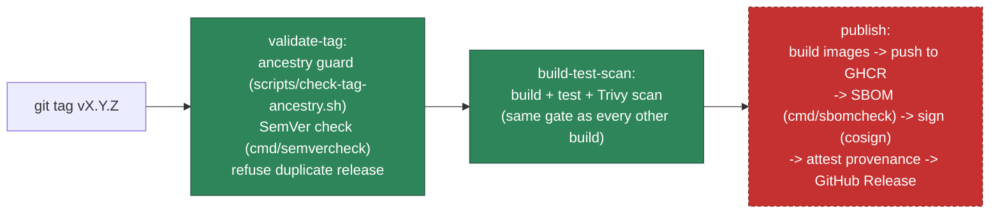

# Trusted releases

**Status: designed and committed locally, NOT YET VERIFIED end-to-end.** `.github/workflows/release.yml`
has never run — it requires a real `v*` tag push, which this phase does not do (see
`docs/adr/0006-f5-templates-releases.md`). Everything below describes the design and what
was verified using **local fixtures** instead of a live run.

## Pipeline overview



**The tagged commit must be reachable from `main`** — enforced by a real `git merge-base
--is-ancestor` check (`scripts/check-tag-ancestry.sh`), not documented practice alone. It
fails closed: a shallow clone, a missing ref, or a commit this repository doesn't know
about are all treated as failure, never as "assume it's fine." Tested against real git
fixtures (a valid `main` commit, a feature-only commit never merged, a missing commit, a
missing ref, and a shallow clone) in `scripts/test-check-tag-ancestry.sh` — run it by hand
whenever the guard itself changes. This is the very first step of `validate-tag`, which
every other job (`build-test-scan`, `publish`) depends on via `needs:` — nothing builds,
signs, or publishes before it passes.

The `publish` job is the one carrying privileged credentials (`contents: write`,
`packages: write`, `id-token: write`, `attestations: write`) and is drawn as the
not-yet-verified step. `validate-tag` and `build-test-scan` are identical in trust level to
every other CI job in this repository.

## Preventing accidental duplicate versions, tag overwrites, and partial releases

- **Duplicate tag/version**: `validate-tag` calls `gh release view <tag>` before anything
  else runs; if a release already exists for that tag, the whole workflow fails
  immediately — nothing is built, nothing is pushed.
- **Tag overwrite**: Git tags are not deleted/re-pushed as part of any ForgeStack
  automation. If a human force-pushes a tag to a different commit, the duplicate-release
  check above still catches it (the release for that tag name already exists) — it does
  not re-publish over it.
- **Partial release**: the GitHub Release itself is created as the **last** step of the
  `publish` job, after images are pushed, SBOMs generated/validated, and signatures/
  attestations created. If any earlier step fails, the job fails and no Release is
  created — there is no state where a Release exists but its artifacts don't (or vice
  versa) from a single run. A failed run before the Release step leaves GHCR with tagged-
  but-unreleased images; this is a known, accepted gap (see "Rollback" below for how to
  deal with that if it ever happens) rather than something an atomic-transaction
  mechanism was built to prevent — GHCR itself has no multi-artifact transaction
  primitive to build on.

## Evidence chain: release version → source commit → build → artifact digest → SBOM → attestation

Every release artifact's metadata links all the way back to source, recorded explicitly
(not left to be inferred):

| Link | Where it's recorded |
|---|---|
| Release version → source commit | The GitHub Release's own `tag_name` (the tag IS a commit pointer) and the release notes include `github.sha` explicitly |
| Source commit → build | `release.yml`'s `build-test-scan` job builds directly from the checked-out tag's commit; the Go binary is built with `-ldflags -X .../buildinfo.Version=<tag>` |
| Build → artifact digest | `docker inspect --format '{{index .RepoDigests 0}}'` immediately after push — the digest, not the mutable tag, is what gets signed and attested |
| Artifact digest → SBOM | `cmd/sbomcheck augment` records the exact `forgestack:commit` property in the SBOM's metadata, generated from the same pushed image |
| Artifact digest → attestation | `actions/attest-build-provenance`'s `subject-digest` input is the resolved digest, not the tag — matching F4's already-verified pattern (see `docs/adr/0005-f4-security-supply-chain.md`'s live verification of `supply-chain-attest.yml`) |

## Local fixture verification (what was actually run this phase)

No registry push, no real tag, no live GHCR/GitHub Release credentials. Verified instead:

```bash
# 1. SemVer validation + compatibility classification (real tool, real tests)
go run ./cmd/semvercheck validate v1.0.0
go run ./cmd/semvercheck compat v1.0.0 v2.0.0   # -> breaking
go run ./cmd/semvercheck compat v1.0.0 v1.1.0   # -> compatible

# 2. Build a local image, generate + augment + validate its SBOM (same
#    tools release.yml's publish job uses, just not pushed anywhere)
docker build -t forgestack:release-fixture .
syft forgestack:release-fixture -o cyclonedx-json=sbom-fixture.cdx.json
go run ./cmd/sbomcheck augment --producer "ForgeStack Release" \
  --repository mangopep/forgestack --commit "$(git rev-parse HEAD)" \
  sbom-fixture.cdx.json sbom-fixture.augmented.cdx.json
go run ./cmd/sbomcheck validate sbom-fixture.augmented.cdx.json

# 3. Sign + verify the fixture SBOM locally (same cosign commands, local
#    key instead of the live keyless/OIDC flow -- see F4's ADR for why
#    that distinction matters and is stated honestly, not glossed over)
cosign generate-key-pair
cosign sign-blob --key cosign.key --bundle sbom-fixture.augmented.cdx.json.bundle sbom-fixture.augmented.cdx.json
cosign verify-blob --key cosign.pub --bundle sbom-fixture.augmented.cdx.json.bundle --insecure-ignore-tlog sbom-fixture.augmented.cdx.json
```

## Verifying a real release (once one exists)

```bash
# Signature (keyless, repository-scoped identity)
cosign verify "ghcr.io/mangopep/forgestack:vX.Y.Z" \
  --certificate-identity-regexp '^https://github.com/mangopep/forgestack/' \
  --certificate-oidc-issuer 'https://token.actions.githubusercontent.com'

# Provenance (GitHub-native attestation)
gh attestation verify oci://ghcr.io/mangopep/forgestack:vX.Y.Z --owner mangopep

# SBOM (attached to the GitHub Release)
gh release download vX.Y.Z --repo mangopep/forgestack --pattern 'sbom-*.cdx.json'
go run ./cmd/sbomcheck validate sbom-go.cdx.json
```

## Rollback

Releases are never rebuilt "fresh" to roll back — the whole point of digest-pinning is
that a prior release's exact bytes are still pullable:

```bash
docker pull ghcr.io/mangopep/forgestack@sha256:<previous-release-digest>
```

If a partial release occurred (images pushed, no GitHub Release — see "partial releases"
above): delete the orphaned GHCR tags manually (`gh api -X DELETE ...` or the GHCR UI) and
re-push a **new** patch tag (never reuse the failed tag name) once the underlying issue is
fixed — consistent with "never silently overwrite a version."

## Security notes

- The `publish` job's elevated permissions (`contents: write`, `packages: write`,
  `id-token: write`, `attestations: write`) are declared on that job only, never at
  workflow level, and the workflow as a whole never triggers on `pull_request` — a fork PR
  cannot reach this job under any circumstance.
- Build dependencies are pinned the same way as every other ForgeStack workflow: Actions
  pinned by commit SHA, base images pinned by digest (see the Dockerfiles).
- This does not, and will not, conceal F4's existing tracked findings (#35, #40): a
  release build still runs the same Trivy scan with the same documented exception for
  #40, and a release is not exempt from any existing gate.
