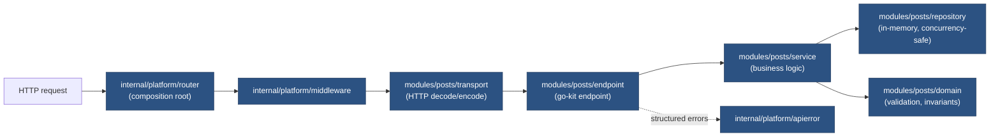
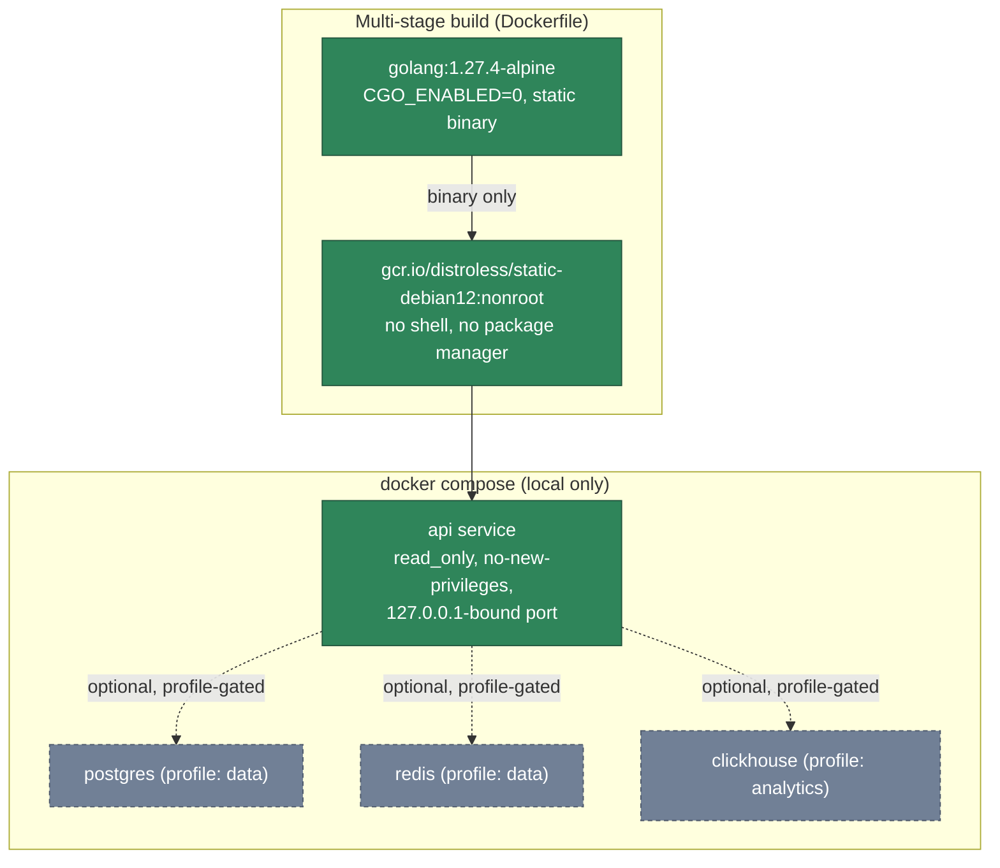

# Application and deployment architecture

**Status: implemented** for the request flow and local Docker build; **not verified** for
anything beyond a local `docker compose` run (no deployed environment exists yet — that's
F9/F7 territory).

## Current application architecture (go-kit layering, ADR 0001)

Each arrow is a real Go import, not an aspirational boundary — `service` has no dependency on
`transport` (business logic doesn't know about HTTP), and `repository` is swappable behind the
same interface the service depends on. See ADR 0001 for the full tradeoff discussion.

## Current Docker / local-deployment architecture

**Not verified beyond local `docker compose up`**: no Kubernetes deployment, no cloud-hosted
instance, no CI job that deploys this image anywhere. `container-scan.yml` builds and scans
the image on every PR (Trivy, HIGH/CRITICAL) but never pushes it to a registry — see
`docs/handbook/RELEASE-WORKFLOW.md` for the planned (not built) build-once/promote-by-digest
pipeline this would need before any real deployment.
