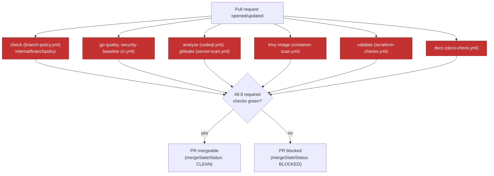
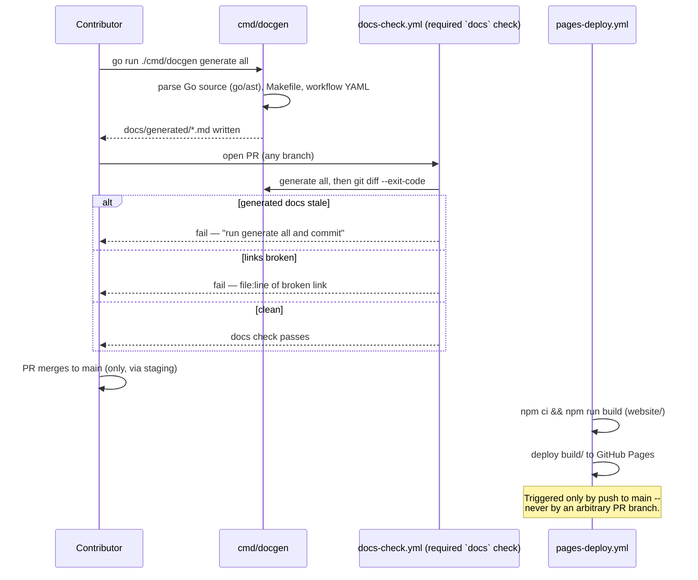

# PR validation and documentation publishing

**Status: implemented.** Both diagrams below reflect the actual workflow files and `cmd/docgen`
behavior as of this page's last regeneration-check — verified against `.github/workflows/*.yml`
and `docs/generated/CI_WORKFLOWS.md`, not hand-guessed.

## PR validation and required CI

Every box under "required" is a real GitHub ruleset `required_status_checks` context on
`main`/`staging`/`develop` (see ADR 0002) — this isn't an aspirational diagram, it's what
`gh api repos/mangopep/forgestack/rulesets/<id>` actually returns as of the F1 migration.
`container-scan.yml` and `terraform-checks.yml` run unconditionally on every PR (no path
filter) specifically so they can never silently skip a required check — see ADR 0002's
"Required-check gap closed" section for why.

## Documentation generation and publishing

The website build itself (`website` job in `docs-check.yml`) runs on every PR as a build-only
check — it never publishes from a PR. Only `pages-deploy.yml`, triggered by `push:
branches: [main]`, actually deploys to GitHub Pages, and it runs with `contents: read, pages:
write, id-token: write` — no broader token scope than the Pages deployment itself needs.
