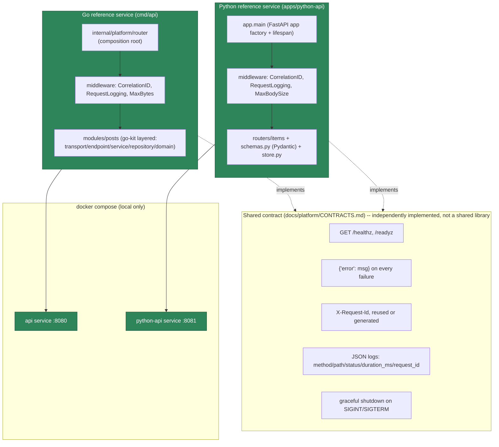

# F3 application foundation: two independent reference services

**Status: implemented.** Both services exist, run, and are tested; see
`docs/platform/CONTRACTS.md` for the full contract specification this diagram
summarizes, and `docs/adr/0004-f3-application-foundation.md` for the decisions behind it.

## Reading this diagram

- The two services share **zero runtime code** — no shared library, no shared base
  image, no shared process. What they share is a documented convention, implemented
  independently in each language's own idiom. This is a deliberate choice (see ADR 0004
  and `CONTRACTS.md`'s "why independent implementations" section): a shared library would
  itself become a dependency every *future* language joining this contract (Rust,
  TypeScript, an AI workload) would need to adopt, which is a heavier commitment than
  documenting a shape each language implements on its own.
- Both services run independently (`docker compose up python-api` or `up api` alone)
  and together (`docker compose up api python-api`) — neither depends on the other.
- Neither service has a real external dependency yet (both use in-memory storage), which
  is why `/readyz` and `/healthz` are equivalent in practice today — see `CONTRACTS.md`
  §2 for why the distinction still exists.

## What this diagram does not show (by design, not omission)

No database, message broker, Kubernetes, or observability backend — none exist yet,
and showing them here would misrepresent current state. See
`docs/architecture/INFRASTRUCTURE-OWNERSHIP.md` for what's planned there, clearly
labeled as not yet built.
