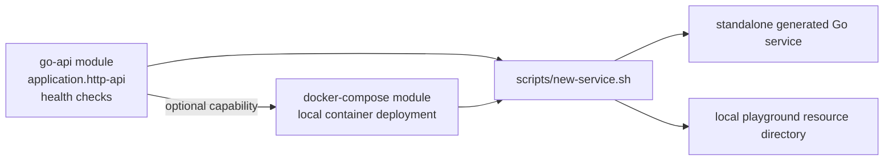

# F6 local composition and playground foundation

**Implemented locally on the F6 feature branch:** a versioned JSON module contract, a
small capability and provider-version resolver, deterministic resolution output, and a
local environment record with scoped cleanup. This is a development foundation. It does
not deploy to AWS, create an automatic expiry controller, or claim production readiness.

## Module contract and composition

Each file in `modules/` declares a module's version, category, provided capabilities,
required and optional capabilities, optional provider-version bounds, languages/runtimes,
configuration keys, secret names, deployment targets, health checks, ownership scope and
cleanup behavior. The contract is intentionally data-only; module code remains in the
existing templates and services.

The first compatible pair is the existing standalone Go API template plus its optional
Docker Compose delivery feature:



Resolve the pair:

```bash
go run ./cmd/modulecheck resolve modules/go-api/module.json modules/docker-compose/module.json
```

Expected output includes `go-api` connected to `docker-compose:deployment.docker-compose`.
Selecting only `go-api` succeeds and reports that the optional deployment capability is
unconnected. A missing required capability, an incompatible provider version, malformed
contract, or duplicate module exits nonzero with a specific error. Output module and
connection lists are sorted and contain no timestamps.

`configuration` fields currently describe the module's accepted values, while `secrets`
identifies values that must come from a secret reference. This increment does not yet
resolve runtime configuration or secret stores. The resolver checks declared module and
capability versions; it is not a plugin loader or runtime dependency injector.

## Products and playgrounds share modules

Both modes use the same module names and generated service artifacts. The local lifecycle
manager records an owner, selected modules, a unique environment ID, timestamps, mode and
status. Playground mode requires a TTL no greater than 24 hours. Product mode has no
expiration and automatic cleanup rejects it. No persistent AWS, Kubernetes or database
resource can be created by this manager.

The local resource boundary is one `resources/` directory under a validated environment
ID. Cleanup checks the owner and mode from `environment.json`, removes only that directory,
checks it is absent, compares sibling inventory names, and retains the ownership record with
`verified_clean`. A failed removal records `cleanup_incomplete`; a failed absence or
inventory check reports `CLEANUP UNVERIFIED`. A repeated cleanup is safe and reports the
already-absent state. It does not use wildcards or accept a user-provided resource path.

Create and clean a playground record:

```bash
go run ./cmd/playground create --root /tmp/forgestack-envs --owner "$USER" --modules go-api,docker-compose --ttl 4h
# Copy the ID from the JSON result, then generate the standalone service into its owned path:
scripts/new-service.sh go /tmp/forgestack-envs/<ID>/resources/app --name sample-api --port 18081 --module example.com/sample-api --features base,docker,ci --validate
go run ./cmd/playground cleanup --root /tmp/forgestack-envs --owner "$USER" --id <ID>
```

Successful cleanup prints `"cleanup":"VERIFIED CLEAN"`. Remove the retained ownership
record only after reviewing it; deleting that record removes local cleanup evidence. The
generator stages output in a temporary sibling directory, refuses an existing destination,
and removes the staging directory on failure. It writes stable provenance without a wall
clock timestamp, so identical inputs produce identical files.

TTL is metadata only in this increment. The user must invoke cleanup; no background
controller survives laptop shutdown. Local verification is limited to the owned directory
and its sibling names. It is not independent cloud inventory verification.

## Terraform and cloud boundary

The existing AWS S3 sample remains opt-in (`enable_resources = false`) and the existing
Terraform workflow runs format, backend-free initialization, validation, and Trivy IaC
scanning. Provider constraints are declared in the sample. Terraform changes should follow
these rules:

- Keep a separate root and state key per environment; do not select production and
  playground from one variable-controlled root.
- Commit `.terraform.lock.hcl`, generated with `terraform init` for every supported
  platform; use `terraform init -lockfile=readonly` in CI. Never hand-edit checksums.
- Keep state out of Git. For future AWS state, use a dedicated encrypted, versioned,
  private bucket, least-privilege access and native state locking; use short-lived OIDC
  credentials when a deployment workflow is separately approved.
- Tag every cloud resource with an environment ID, owner, mode and managed-by value.
  Cleanup must compare state with independently queried cloud inventory and only target
  positively owned resources.
- Continue backend-free CI validation and Trivy config scanning. Never run `apply` or
  `destroy` in CI for this repository.

The repository's sandbox currently has no committed lockfile or remote state backend; the
conventions above do not claim either is operational. The future AWS adapter should
implement the same module/environment contract, with durable idempotent cleanup jobs and
independent resource reconciliation. It must report incomplete or unverified cleanup rather
than infer success from Terraform alone. That adapter is not implemented or tested here.

## Extension boundaries and limitations

Categories are extensible: future AI, MCP, RAG, observability, Kubernetes and AWS modules
can use the same manifest contract. No placeholder implementations were added. A category
name alone does not mean a module or adapter exists. The current verified example is the
existing Go service template with its optional Docker Compose files; Postgres is not wired
to that service, and Docker daemon execution may be unavailable on a local machine.

There is no production mode deployment engine, secret backend, automatic TTL worker,
Terraform remote state, cloud cleanup controller, resource cost estimator, or cloud
inventory verification. Do not use this increment to manage real infrastructure.
