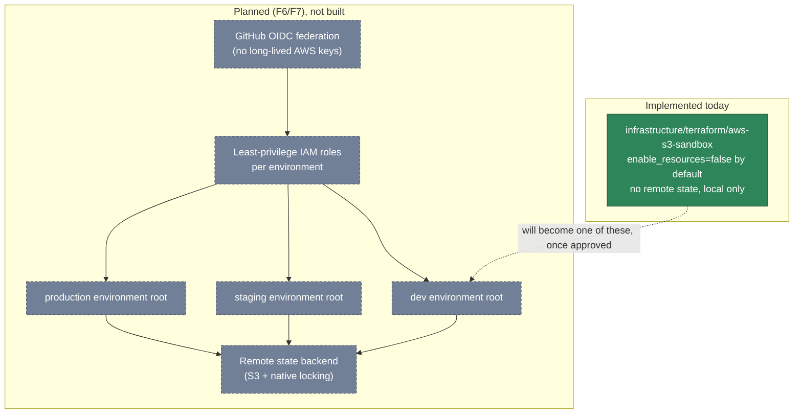

# Infrastructure ownership and environment isolation

**Status: mostly planned.** Only the sandbox Terraform example (greyed below as "opt-in,
not deployed") exists today. No AWS account structure, no multiple environments, and no
Terraform remote-state backend have been built — this diagram shows the intended shape (per
`docs/COST-SAFETY.md` and the F6/F7 roadmap modules) so later work has a target, not a claim
that it's running.

**Why isolate environments by Terraform root, not just by variable**: a shared Terraform root
with environment-conditional resources means one `apply` can affect every environment's state
at once. Separate roots per environment (even reusing the same modules) bound the blast radius
of any single `apply` to the environment it targets. None of this exists yet — see
`docs/COST-SAFETY.md` for the cost-safety rules that will govern it once it does, and the F1
branch-promotion flow (`main` = production-approved) this will eventually gate deployments
behind.
