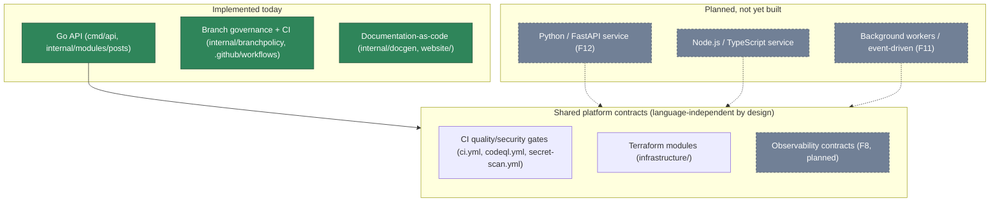
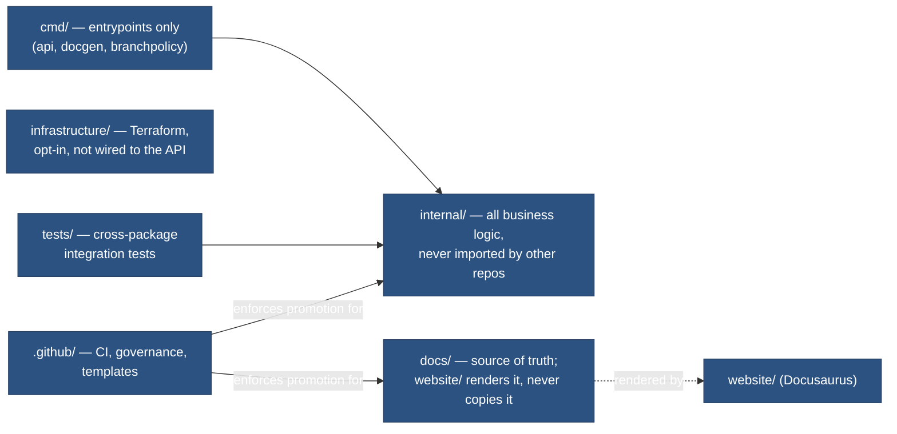

# Platform overview

**Status: implemented** for the Go application layer and its surrounding CI/governance;
**planned** for the multi-language and infrastructure layers shown greyed below. This page
does not claim those planned layers exist — see `docs/ROADMAP.md` for the module that builds
each one.

## Language-independent boundaries

The point of this boundary: `ci.yml`'s quality/security gates, the Terraform module
conventions, and the branch-promotion policy are all designed to apply to *any* service added
later, regardless of language — nothing in `internal/branchpolicy` or the required-checks list
is Go-specific. A future Python or Node service would plug into the same `feature/* → develop →
staging → main` flow and the same required-checks shape, not a parallel one.

## Repository separation of concerns

Each root folder has exactly one responsibility (per the repo's engineering rules): `cmd/`
never contains logic beyond wiring, `internal/` is never imported outside this repository
(Go's own `internal/` visibility rule enforces this), and `website/` never holds hand-written
content — it is purely a renderer over `docs/`.
