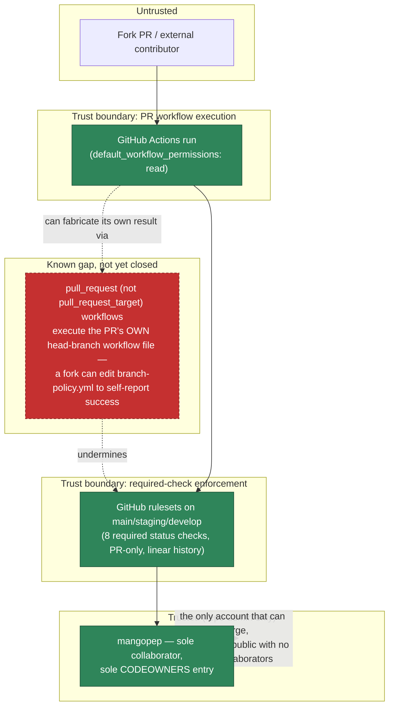

# Security trust boundaries

**Status: implemented** for the boundaries shown solid; **known, unresolved gap** shown
dashed/red — documented, not hidden. See `docs/handbook/MIGRATION-CHECKLIST.md` (local to the
F1 work; not yet merged) and ADR 0002 for the full detail behind the gap below.

**Why this gap is recorded here instead of silently fixed**: closing it properly means either
requiring manual approval for every outside contributor's workflow run (Settings → Actions →
General — not yet verified as configured) or moving every required-check workflow from
`pull_request` to `pull_request_target` (a bigger change with its own risks — `pull_request_
target` runs with the base branch's secrets available, which is its own trust boundary to get
right). Today's actual mitigation is procedural: `default_workflow_permissions: read` and
`can_approve_pull_request_reviews: false` (confirmed live) mean a forged check cannot also
forge a review or merge itself — a human still has to click merge, and should diff-review any
PR touching `.github/workflows/`, `internal/branchpolicy/`, or `cmd/branchpolicy/` before
trusting its green checks. Low urgency today (solo maintainer, no external PRs observed yet)
but a real gap the moment that changes.

## Other boundaries, for completeness

- **Secrets**: `gitleaks` (that PR's commits — not full history, confirmed from a live run; a
  deeper full-history scan runs locally/on demand, see `docs/security/VULNERABILITY-LIFECYCLE.md`)
  + `scripts/review_guard.py` (baseline patterns) scan every PR; `GITHUB_TOKEN` is
  `permissions: read` by default per workflow, elevated only where a specific job needs it
  (e.g. `codeql.yml`'s `security-events: write`).
- **Dependencies**: `govulncheck` (reachable-vulnerability analysis, not just version
  matching) + Dependabot (grouped PRs per ecosystem) + CodeQL.
- **Container**: Trivy scans the built image on every PR (HIGH/CRITICAL fails the build);
  the runtime image is `distroless`, non-root, with no shell — reduces what a compromised
  process could even do if one of the above missed something.
