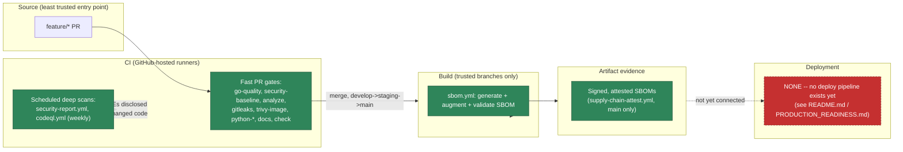

# Supply-chain security

**Status: implemented locally, not yet verified on a live CI run** (F4 commits to
`feature/f4-security-supply-chain` only; nothing has been pushed). See
`docs/adr/0005-f4-security-supply-chain.md` for the decisions behind what follows, and
`docs/architecture/SECURITY-TRUST-BOUNDARIES.md` (F1) for the boundaries this document
extends rather than repeats.

## Trust boundaries: source → CI → build → artifact → deployment



**Honest gap, not hidden**: there is no deployment pipeline, so "artifact promotion" ends
at signed/attested SBOMs in GitHub Actions artifact storage — it does not yet connect to
a running environment. Claiming runtime coverage without runtime evidence would violate
F4's own instruction, so this document doesn't.

## Attack paths

- **Untrusted PR execution**: unchanged from F1's own documented gap (see
  `SECURITY-TRUST-BOUNDARIES.md`) — a fork PR's `pull_request`-triggered workflow runs
  with the PR's own workflow file, so a forged check is theoretically possible. F4 adds
  nothing to this specific gap; it's recorded, not re-solved, here. F4's own new jobs
  (signing, attestation) are scoped to `push: [main]` only, specifically so a fork PR
  never gets `id-token`/`attestations` write access regardless of that gap.
- **Dependency compromise (supply chain)**: mitigated by `govulncheck` (reachability-
  aware, not just version-matching), `pip-audit`, `npm audit` (baseline-tracked, see
  `VULNERABILITY-LIFECYCLE.md`), Dependabot (grouped PRs per ecosystem), and now SBOMs
  that record every transitive dependency with (where available) its hash and license —
  an auditor can check "was this exact version ever vulnerable" after the fact, not only
  at scan time.
- **Base-image compromise**: Dockerfiles pin base images by **digest**, not just tag (a
  tag can be silently repointed; a digest cannot) — see the `Dockerfile` and
  `apps/python-api/Dockerfile` comments for the re-resolution procedure.
- **CI credential/signing-key compromise**: there are no long-lived signing credentials
  in this repository to compromise — `supply-chain-attest.yml` uses Sigstore **keyless**
  signing (a short-lived OIDC identity minted per-run, never a stored private key) and
  GitHub's native `attest-build-provenance`. The only cosign *private* key ever created
  during F4's work was a local, throwaway test keypair, deleted within the same session
  (not committed, not reused) — see the ADR for the exact commands run.

## Artifact verification and rollback

```bash
# Verify a signed SBOM's signature (keyless, Sigstore transparency log)
cosign verify-blob --bundle sbom-go-image.cdx.json.bundle \
  --certificate-identity-regexp '^https://github.com/mangopep/forgestack/' \
  --certificate-oidc-issuer 'https://token.actions.githubusercontent.com' \
  sbom-go-image.cdx.json

# Verify GitHub-native build provenance (requires gh CLI, run against a real artifact)
gh attestation verify sbom-go-image.cdx.json --owner mangopep
```

**Rollback**: there is no deployed artifact to roll back (see the honest gap above). For
the signing/SBOM infrastructure itself: every workflow added in F4 is additive (new
files) — reverting F4 means reverting those files, which this repository's existing
branch-promotion flow already handles as an ordinary PR revert, no special procedure
needed.

## Vulnerability response and exceptions

See `docs/security/VULNERABILITY-LIFECYCLE.md` for the full Detection → Triage →
Remediation → Verification → Closure process and the exception format.

## Security incident and disclosure procedure

Unchanged from `SECURITY.md` (F1) — report via GitHub's private Security Advisories
feature, not a public issue. F4 adds no new disclosure channel; it adds evidence
(SBOMs, VEX, the generated report) that would inform triage of a real report, nothing
more.

## SBOM and artifact retention, access, and sharing

- **Retention**: SBOM/report/VEX artifacts uploaded by CI (`actions/upload-artifact`)
  are retained for 90 days — GitHub Actions' own storage, subject to GitHub's own
  retention and access controls, **not** a separately-enforced immutable store. This
  repository does not claim otherwise: an artifact can be deleted by anyone with repo
  write access, same as any other GitHub Actions artifact. If immutable, longer-lived
  storage is ever needed, that is a distinct, future, explicitly-approved decision (e.g.
  publishing to a registry with retention policies), not implemented here.
- **Access**: artifacts inherit the repository's own access control — anyone who can
  read the repository's Actions runs can download them. No customer-facing or
  third-party sharing mechanism exists yet; "share an SBOM with a customer" today means
  manually exporting `secreport.json`/the relevant `*.cdx.json` file from a workflow run,
  not an automated or self-service process.
- **Exceptions**: tracked exclusively in `docs/security/findings-register.json` (and the
  narrower, CI-enforced files it cross-references — `website/.security/npm-audit-
  baseline.json`). There is no separate, hidden exception list; if it isn't in that
  register, it isn't an approved exception.
- **Review policy**: every exception has an explicit `review_date`; both
  `scripts/check-npm-audit-baseline.py` and `cmd/secreport`'s VEX validation
  (`internal/secreport.ValidateVEX`) fail loudly, not silently, once that date passes.

## Compliance evidence mapping

**This is a mapping of existing technical controls to framework control families for
audit-preparation reference. It is not a certification, an attestation of compliance, or
a claim that any audit has occurred.** No control below has been independently assessed
by an auditor.

| Control family (representative) | Framework reference (examples) | Technical evidence in this repository |
|---|---|---|
| Vulnerability management | SOC 2 CC7.1; ISO 27001 A.8.8; PCI DSS 6.3.1/11.3 | `govulncheck`/`pip-audit`/`npm audit`/Trivy run on every PR and weekly; findings tracked in `docs/security/findings-register.json` with owner + review date |
| Secure development lifecycle | NIST SSDF PW.4, PW.7, PW.8 | SAST (CodeQL, 3 languages), Dockerfile linting (hadolint), IaC scanning (Trivy config), branch-protection-gated PRs on every change |
| Secrets management | SOC 2 CC6.1; ISO 27001 A.8.24; PCI DSS 3.5/3.6 | `gitleaks` full-history scan on every PR; no committed secrets found (verified this session); no long-lived signing credentials exist to manage |
| Software composition / SBOM | NIST SSDF PW.4.1; PCI DSS 6.3.2 (to the extent it applies) | CycloneDX SBOMs for the Go module and both container images, validated against NTIA/CISA minimum elements (`cmd/sbomcheck`) |
| Build integrity / provenance | SLSA v1.0 (see below); NIST SSDF PS.1-PS.3 | `actions/attest-build-provenance` (GitHub-native, in-toto-based) on `main`-only builds; Sigstore keyless signing |
| Change management | SOC 2 CC8.1; ISO 27001 A.8.32 | Branch-protection rulesets (8 required status checks, PR-only, zero bypass actors), gitflow promotion (F3) |
| Access control (CI) | SOC 2 CC6.1; ISO 27001 A.8.3 | Least-privilege `permissions:` block per workflow (verified in `docs/adr/0005-f4-security-supply-chain.md`); signing/attestation jobs scoped to `push: [main]`, never `pull_request` |
| AI/automation system governance | ISO/IEC 42001 (AI management system) clauses 8.1/8.2 (operational planning, risk treatment) | Not independently assessed; this repository's own AI-assisted engineering work (Claude Code sessions) is governed by `CLAUDE.md`'s working protocol and human-approval boundaries for risky actions, not a certified AI management system. Recorded here as a mapping candidate, not a claim. |

**Audit & Trust evidence linkage**: every `cmd/secreport` report and VEX document carries
`product`/`environment`/`owner`/`commit` fields precisely so a future auditor can trace any
piece of evidence back to what it covers and who is accountable for it — see
`docs/ROADMAP.md`'s "Audit & Trust" module for the phased plan and
`docs/security/findings-register.json`'s `control_type` field (`automated` vs `manual`) for
how this repository keeps scanner-verified claims and human-organizational claims from
being conflated.

**ForgeStack never self-issues a certification.** Nothing in this repository, this report
generator, or any future Trust Center built on it is a substitute for an actual
independent audit. If a real external certification is ever obtained for a product built
on ForgeStack, the roadmap's future work tracks it as issuing authority + verified scope +
issuance/expiry dates — a recorded fact about an external event, never something this
tooling grants itself.

### SLSA alignment (build provenance)

`actions/attest-build-provenance` produces in-toto-shaped provenance consistent with
**SLSA v1.0**. On GitHub-hosted runners with the standard `GITHUB_TOKEN` OIDC trust (this
repository's setup), this corresponds to roughly **SLSA Build Level 2** (the provenance
is generated by a hosted build service and is tamper-resistant via the Sigstore
transparency log) — **not independently verified or claimed as a higher level**, and
**not yet exercised on a live run** (see "Not yet verified," ADR 0005).

## Future integration points (explicitly deferred, not attempted)

Per F4's own instruction not to build more than current needs justify:

- **Dependency-Track**: a dedicated SBOM-ingestion/continuous-monitoring platform.
  `cmd/secreport`'s CycloneDX output is already a valid input format if this is adopted
  later — no rework needed to start.
- **CBOM** (Cryptography Bill of Materials): would matter once this codebase uses
  nontrivial cryptography beyond TLS/Sigstore's own; not yet justified.
- **SaaSBOM**: this is not a SaaS product; not applicable today.
- **AI/ML-BOM**: no AI/ML models are shipped by this codebase; not applicable today.

## Future AI/ML security and governance

This codebase ships no AI/ML models today, so AI/ML-specific supply-chain controls (model
provenance, training-data lineage, an AI/ML-BOM) are not yet applicable — listed above, not
built. What *does* already apply, today, is governance of the **AI-assisted engineering
process** itself: this repository's own development sessions use Claude Code, governed by
`CLAUDE.md`'s working protocol (explicit approval gates for irreversible/security-sensitive
actions, mandatory audit-before-implement, evidence labeling) and `.claude/hooks/guard.py`'s
deny-list for obviously dangerous commands. This is **not** a certified AI management system
and is not claimed as one — see the ISO/IEC 42001 row in the compliance table above, which
records this honestly as an unassessed mapping candidate, not a compliance claim.

If a real AI/ML feature ships from this codebase in the future (e.g. the `21` curriculum
module's "AWS Bedrock, RAG, embeddings" work in `docs/ROADMAP.md`), that would be the trigger
to revisit AI/ML-BOM and model-provenance tooling as its own reviewable addition — not
something to build speculatively now.

## Local scanning and report-generation commands

See `docs/security/VULNERABILITY-LIFECYCLE.md`'s "Local reproduction" section — not
duplicated here.

## Limitations (stated honestly)

- No live CI run of any F4 workflow has happened (nothing pushed this phase).
- `supply-chain-attest.yml`'s keyless signing/attestation steps have never executed in
  GitHub's real OIDC environment — only the underlying `cosign sign-blob`/`verify-blob`
  mechanics were proven locally with a throwaway key-pair (not the keyless flow itself).
- SBOM license coverage is incomplete for several ecosystems (Go modules in particular
  rarely carry machine-readable license metadata without a deeper scan) — reported
  honestly as a coverage gap by `cmd/sbomcheck`, not hidden or claimed as 100%.
- No runtime/deployment evidence exists because no deployment exists.
