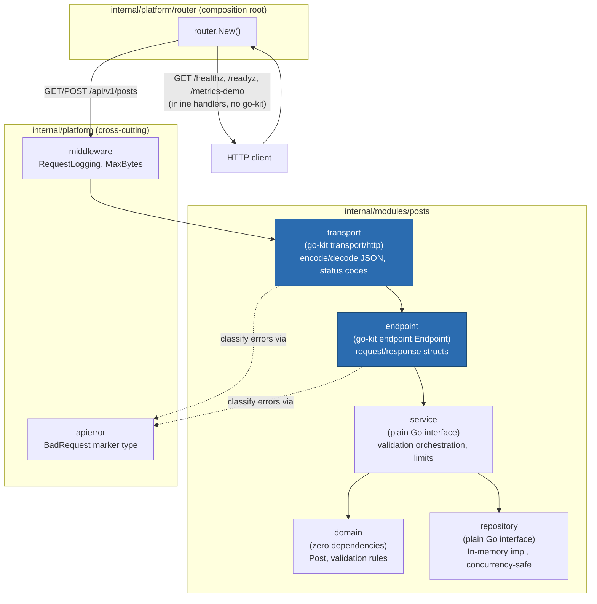

# Posts module architecture

This diagram matches the code as implemented in this milestone (not an aspirational future
state). See `docs/adr/0001-go-kit-for-posts-module.md` for why go-kit was scoped to exactly the
two packages shown here.

**What the blue boxes mean**: `transport` and `endpoint` are the only packages in this module
that import go-kit. `domain` and `service` import nothing from go-kit and nothing from
`net/http` — they can be, and are, unit-tested with no HTTP server and no go-kit types
involved (see `internal/modules/posts/service/service_test.go`, which uses a fake repository).

**Why this shape**: if go-kit needs to be replaced later (see the ADR's maintenance-risk
discussion), only `transport` and `endpoint` need rewriting. `domain`, `service`, and
`repository` are unaffected.
