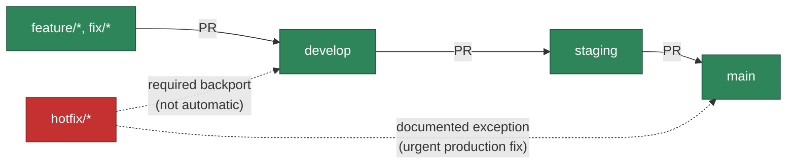

# Branching and release flow

See `docs/adr/0002-gitflow-branching-strategy.md` for the full decision record, the ruleset
specification, and the migration plan. This page is the short, practical version for
contributors.

**Status**: this flow is implemented and tested locally (`internal/branchpolicy`,
`.github/workflows/branch-policy.yml`). The `develop` and `staging` branches themselves,
and the GitHub rulesets that would enforce this on the live repository, have **not** been
created yet — that migration is pending explicit maintainer approval. Today, `main` is still
the only long-lived branch and the only one anything actually merges into.

## The flow, once migration happens

## What's enforced automatically

`.github/workflows/branch-policy.yml` runs `cmd/branchpolicy` on every pull request and fails
the check if the PR's base branch doesn't match an allowed source for it:

- `develop` only accepts PRs from `feature/*`, `fix/*`, or a `hotfix/*` backport (or anything
  else not otherwise restricted — it's the normal entry point).
- `staging` only accepts PRs from `develop` or `release/*`.
- `main` only accepts PRs from `staging` (normal promotion) or `hotfix/*` (documented
  exception).
- Dependabot PRs are exempt from this check entirely.

If your PR gets blocked, the check's failure message tells you exactly why and what the
correct base branch is — retarget the PR rather than asking for the check to be disabled.

## Hotfix exception

A `hotfix/*` branch may target `main` directly, skipping `develop`/`staging`, for genuinely
urgent production fixes. This is the only exception. **It does not backport itself** — after
the hotfix lands on `main`, open a second PR from the same `hotfix/*` branch into `develop` so
the fix isn't lost the next time `develop` is promoted. The branch-policy check explicitly
permits that backport PR.

## Why promote through three branches instead of just `main`

Promoting the exact same reviewed, tested commit from `develop` → `staging` → `main` means
every stage runs identical CI checks against identical code — nothing is rebuilt differently
per environment, so "it passed staging" is actually evidence about what will run in
production. The alternative (separate branches with separately-applied changes) loses that
guarantee. See ADR 0002's "Deferred" section for the planned build-once/promote-the-digest
pipeline that will make this guarantee literal (the same container image digest, not just the
same source code) once it's built.
