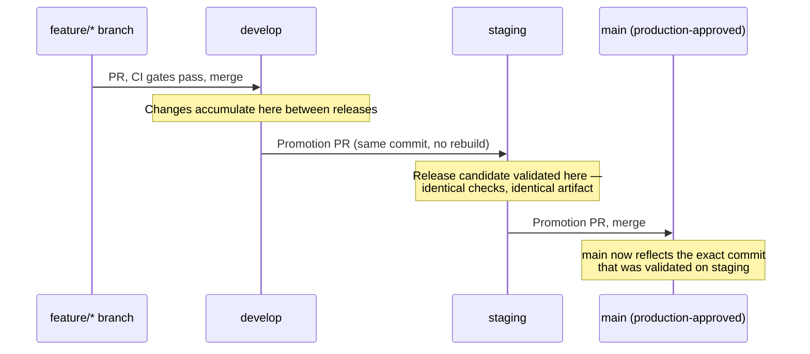

# Release-promotion workflow (foundation, not yet built)

This describes the **intended** release flow once `develop`/`staging` exist and the branch
policy is enforced live. It documents the destination so later work has a target; it does not
deploy anything, publish anything, or touch AWS. See "Deferred to a later milestone" in
`docs/adr/0002-gitflow-branching-strategy.md` for the explicit list of what that would require
and why it's intentionally not attempted yet.

## The intended sequence

1. **A change is tested and merged into `develop`** via a normal `feature/*` → `develop` PR,
   gated by the full CI suite (`go-quality`, `security-baseline`, `analyze`, `gitleaks`,
   `docs`, `check`, and `trivy-image`/`validate` when relevant).
2. **A controlled PR promotes `develop` into `staging`.** This PR carries the exact commit(s)
   already validated on `develop` — nothing is cherry-picked or rebuilt differently.
3. **`staging` validates the release candidate.** The same CI gates run again against the same
   code (not a different build), which is the entire point: "it passed staging" becomes
   evidence about what will run in production, because it's literally the same source.
4. **An approved PR promotes the release from `staging` into `main`.** Once merged, `main`
   reflects exactly what staging validated.

## Why "the same commit," not "the same source code rebuilt"

Promoting the same reviewed Git commit through `develop → staging → main` guarantees identical
*source*. It does not yet guarantee an identical *build artifact* — today, each environment
(if deployment existed) would rebuild the container image fresh from that source, which means
build-time differences (base image patch versions pulled at build time, toolchain drift) could
still produce a different artifact per stage. Closing that gap requires a build-once,
promote-the-digest pipeline: build the container image exactly once (at the `develop` →
`staging` promotion, or even earlier), compute its content digest, and reference that exact
digest at every later stage — never rebuild.

## What "immutable, versioned artifacts" means here, concretely

- **Build once**: a single container image build per release candidate, not one per
  environment.
- **Content-addressed**: the image is referenced by its digest (`sha256:...`), not a mutable
  tag like `:latest` or even `:staging` — a tag can be silently repointed; a digest cannot.
- **Versioned**: a human-readable version tag (e.g. from a `release/*` branch name or a Git
  tag) is attached alongside the digest for traceability, but the digest is what's actually
  deployed.
- **Provenance**: an SBOM (software bill of materials) and build provenance attestation travel
  with the artifact, so "what's running in production" is answerable without re-deriving it
  from source.

None of this is built yet. It depends on `develop`/`staging` existing first (this ADR's
migration plan), and is sized as its own reviewable change — see ADR 0002's "Deferred to a
later milestone" section for the explicit list (GHCR publishing, SBOM/provenance generation,
GitHub Environments) and why attempting it now would violate "work incrementally" and
"don't deploy or publish without approval."

## Where this fits with branch-policy enforcement

`internal/branchpolicy` already enforces the *branch-name* shape of this sequence
(`develop` → `staging` is permitted, `staging` → `main` is permitted, nothing else is). The
artifact-promotion pipeline described above is a separate, later concern: it's about what gets
*built and deployed* at each stage, not about which PRs are allowed to exist. Both matter, but
they're independently reviewable changes.
