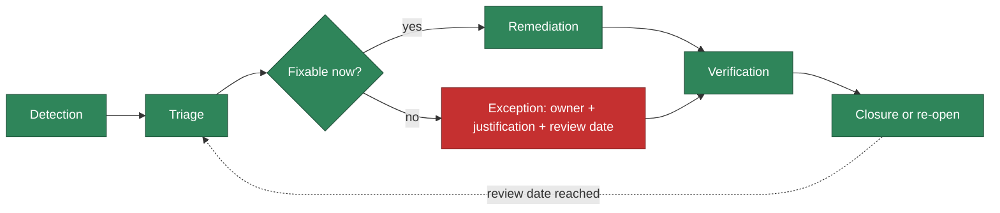

# Vulnerability lifecycle

**Status: implemented** for the process and tooling below; the scanners, SBOM generation,
and report generation have all been run and verified locally (see
`docs/adr/0005-f4-security-supply-chain.md`). **Not yet verified**: a live GitHub Actions
run of `security-report.yml`, `sbom.yml`, or `supply-chain-attest.yml` -- F4 commits
locally only, it does not push.

## Detection → Triage → Remediation → Verification → Closure



1. **Detection** — automated: `govulncheck` (Go, reachability-aware), `pip-audit` (Python),
   Trivy (container images and Dockerfiles), `npm audit` (website build tooling),
   `gitleaks` (committed secrets, that PR's commits — `secret-scan.yml` does not scan full
   history automatically on every PR, despite checking out with `fetch-depth: 0`; confirmed
   from a live run: "2 commits scanned" on a 2-commit PR, not the repository's full history.
   A full-history scan is run locally/on demand instead, see below), CodeQL (Go/Python/JS-TS
   SAST). All run on
   every PR to `develop`/`staging`/`main` (`ci.yml`, `python-ci.yml`, `container-scan.yml`,
   `secret-scan.yml`, `codeql.yml`) and again on a weekly schedule
   (`security-report.yml`, `codeql.yml`) to catch a CVE disclosed against code that hasn't
   changed.
2. **Triage** — for each new finding: is there a fixed version available? Is the
   vulnerable code actually reachable in this service (govulncheck already answers this
   for Go; for others, a human judgment call recorded in the finding/exception)?
3. **Remediation** — if a safe fix exists (a version bump that doesn't break tests/
   compatibility), apply it directly; this is the default path, not the exception.
4. **Exception** (only when no safe fix exists yet) — recorded in
   `docs/security/findings-register.json` with: severity, affected component, fixed
   version (or "none available" with evidence), exploitability context, environment,
   **owner**, evidence, remediation plan, and a **review date**. Never a blanket, open-
   ended suppression — see "Why these are 'affected,' not 'not_affected'" below.
5. **Verification** — `cmd/secreport` reads the real scanner outputs (never assumes) and
   computes `OverallStatus`; it is impossible for the report to claim `PASS` while a
   required scanner's evidence is missing (`internal/secreport/report.go`'s
   `computeOverallStatus` — see its own tests for the exact rule).
6. **Closure** — an exception closes when either the underlying CVE gets a real fix
   (upgrade applied, exception removed) or its review date is reached and it's
   consciously re-extended (not silently carried forward --
   `scripts/check-npm-audit-baseline.py` and `cmd/secreport`'s VEX validation both fail
   loudly on an expired review date).

## Currently tracked findings/exceptions

See `docs/security/findings-register.json` for the full, structured record. Summary:

| ID | Title | Status | Review by |
|---|---|---|---|
| [#35](https://github.com/mangopep/forgestack/issues/35) | 26 npm audit findings, website build tooling | **Open, tracked** (closed 2026-11-13 by maintainer, reopened same day — vulnerabilities re-verified still present, live CI re-check) | 2026-12-12 |
| [#36](https://github.com/mangopep/forgestack/issues/36) | Mobile layout verification | **Closed** (2026-11-13); not a security finding either way, not reopened | N/A |
| [#40](https://github.com/mangopep/forgestack/issues/40) | 98 Python base-image OS CVEs, no fix available | **Open, tracked** (closed 2026-11-13 by maintainer, reopened same day — unfiltered Trivy re-scan confirms all 98 still present) | 2027-02-13 |

**Issue-tracker state is not the same as control state, and neither claims remediation.**
#35 and #40 were both closed by the maintainer directly on GitHub (`stateReason: COMPLETED`,
no linked PR) and then reopened the same day once re-verification showed the underlying
vulnerabilities are still present and unresolved — closing a tracking issue doesn't fix
anything, and reopening it is not a claim that anything got worse either, only that it was
never actually fixed. `website/.security/npm-audit-baseline.json` and Trivy's
`ignore-unfixed` exception were never removed and remain active regardless of either issue's
tracker state. `docs/security/findings-register.json` is the
source of truth for exact timestamps and reasoning.

## Why these are "affected," not "not_affected" in the generated VEX document

`cmd/secreport`'s `BuildVEX` (`internal/secreport/vex.go`) deliberately never claims
`not_affected` for a suppressed/unfixed Trivy finding. It would be easy to claim "not
reachable" for all 98 of #40's findings and call it done — but that claim would only be
honest if each CVE's specific code path had actually been checked against this service's
actual usage. That per-CVE analysis has not been done for all 98 individually (it has,
narrowly, for the overall exception — no `kadmind`/KDC, no `sqlite` usage, no `mount`
operations in this service — recorded in the register above). The generated VEX
statements reflect that honestly: status `affected`, with the real mitigating context
(non-root, read-only filesystem, no shell, all capabilities dropped) recorded as
`status_notes`, not as a reachability guarantee it can't back up.

**This VEX document does not drive CI.** The actual suppression mechanism in CI is
Trivy's `ignore-unfixed` flag (for #40) and the baseline-count comparison script (for
#35) -- both narrower, both independently justified, both documented in their own
workflow/ADR. The VEX document is additional, human-reviewed assessment evidence, exactly
as F4 requires ("never automatically suppress CVEs solely from VEX claims").

## Rechecking previously released components

Scanner vulnerability databases (the Go vulnerability database, Trivy's, PyPI's via
pip-audit) update independently of this repository's own commits — a component shipped
months ago can have a new CVE disclosed against it today with zero code change here.
`security-report.yml` and `codeql.yml` both run on a weekly schedule (not just on push)
specifically to catch that case. If a scheduled run finds something new, it is triaged
exactly like a PR-time finding (see the lifecycle above) — the recheck process is not a
separate, lesser process.

## Local reproduction

```bash
# Go
govulncheck -json ./... > govulncheck.json

# Python (from apps/python-api/)
pip-audit --requirement requirements-lock.txt --format=json > pip-audit.json

# Container images (from the repo root; build the image first)
trivy image --severity HIGH,CRITICAL --format json --output trivy-go-image.json forgestack:local
trivy image --severity HIGH,CRITICAL --format json --output trivy-python-image.json forgestack-python-api:local
# Note: this is the UNFILTERED scan, deliberately without --ignore-unfixed -- the CI
# gate's ignore-unfixed is a build-blocking exception, not evidence-hiding.

# Secrets (full history)
docker run --name gitleaks-local -v "$PWD:/repo" zricethezav/gitleaks:latest \
  detect --source=/repo --report-format=json --report-path=/repo/gitleaks-report.json --no-banner
docker rm gitleaks-local

# website/ dependencies
cd website && npm audit --json > ../npm-audit.json

# Assemble the report + VEX document from the evidence above
go run ./cmd/secreport \
  -govulncheck govulncheck.json -pip-audit pip-audit.json \
  -trivy-go-image trivy-go-image.json -trivy-python-image trivy-python-image.json \
  -gitleaks gitleaks-report.json -npm-audit npm-audit.json \
  -npm-audit-baseline website/.security/npm-audit-baseline.json \
  -json-out secreport.json -md-out secreport.md -vex-out vex.json
```
